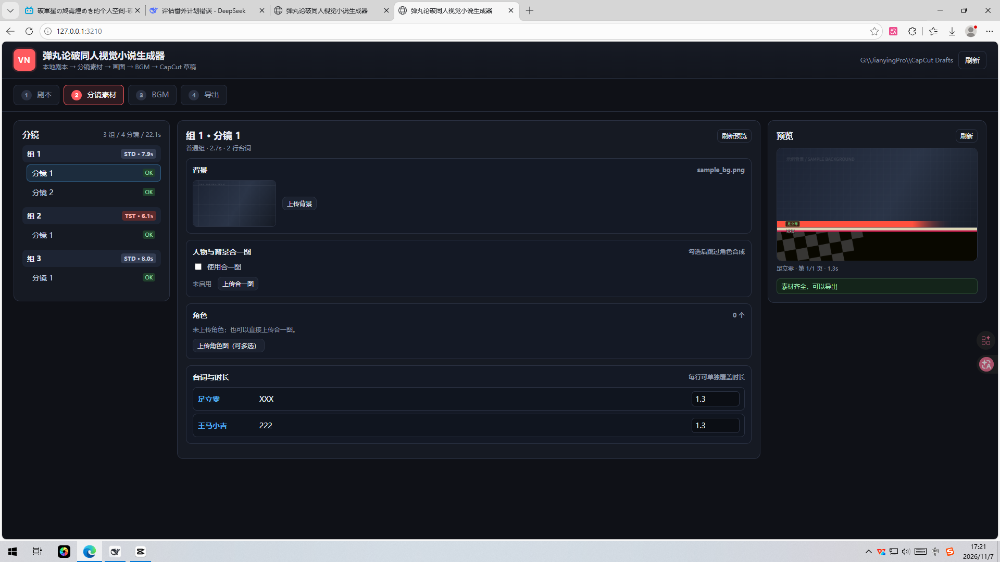
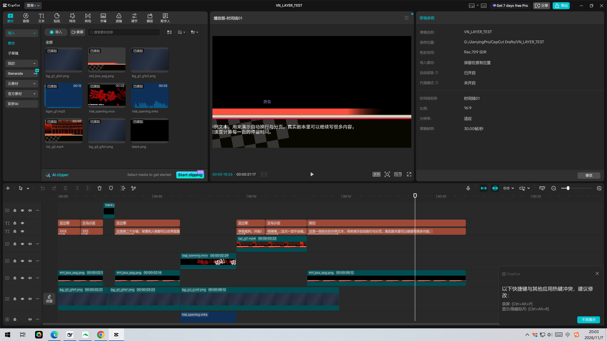
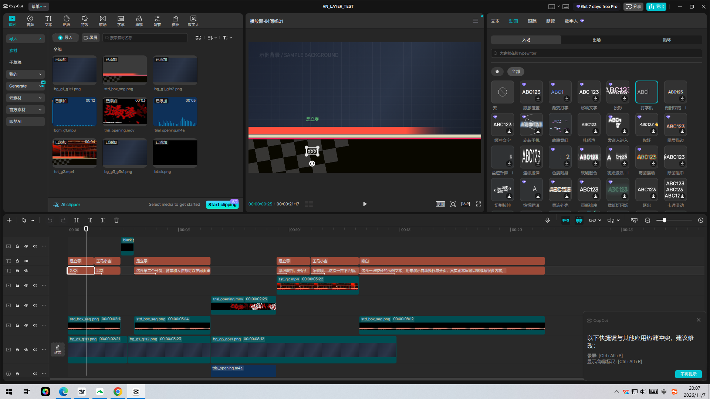
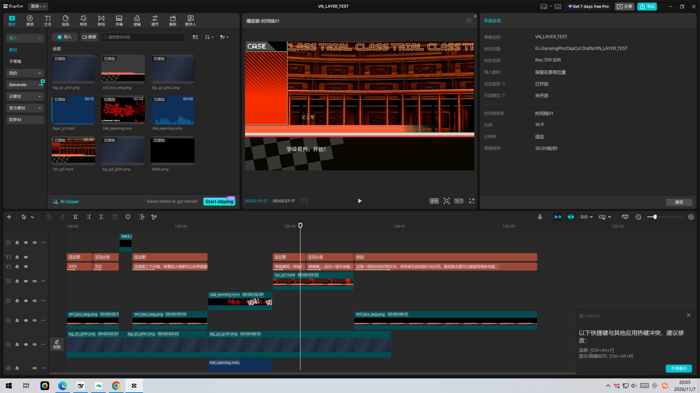

# 弹丸论破同人视觉小说生成器（Windows 本地原型 v0.2）

把按格式编写的 txt 剧本变成 **CapCut 草稿**：自动合成背景、角色立绘和内置对话框，按组配 BGM，插入学级裁判开庭视频，生成带可编辑文字图层、打字机动画和淡入淡出转场的 CapCut 工程。

> 这是可运行的 Windows 本地原型。完整双端原生 App（Flutter + Android MP4）仍在后续阶段；当前版本已把“剧本 → 画面 → 分层草稿 → CapCut”整条链路跑通，并在 **CapCut 9.0.0** 中实测打开。





---

## v0.2 本次更新

- **草稿自包含**：背景、人物、对话框、TST 视频、开庭视频/音效、BGM、字体全部复制进草稿的 `materials/`，并改写为草稿内路径；安装到 CapCut 时自动重写路径前缀。
- **图层拆分**：`背景` / `人物` / `对话框` / `开庭` / `学裁画面` / `台词` / `姓名` / `转场` / `开庭音效` / `BGM` 十条轨道。
- **黑色淡入淡出转场**：默认 0.6s（前后各 0.3s），用黑色纯色图片 + 不透明度关键帧实现；转场期间人物、对话框、姓名、台词全部结束，只保留背景和转场层。
- **学级裁判开庭**：每个 TST 组前自动插入 `学级裁判开庭.mov`（2.972s，含音频），之后才进入学裁画面。
- **台词打字机动画**：使用 CapCut 免费内置的 **Typewriter（打字机）**，resource id `7210980292243231233`；动画时长为图层时长的 28%（落在 1/4~1/3 之间），最短 0.3s、最长 1.6s。
- **文字时长优化**：20 个中文字约 **2.95 秒**，不再偏慢；公式为 `0.35 + 0.13 × 字数 + 0.06 × 标点数`，最短 1.2s、最长 10s。
- **Flutter 已安装**：Flutter 3.47.9 stable 位于 `F:\flutter`，已加入用户 PATH。





---

## 当前已实现

- **剧本解析**：支持 `[组 N:begin][STD]` / `[组 N:begin][TST]` / `[分镜 N:begin]` / `说话人：台词` / `end`；支持任意标签、UTF-8/GB18030、全角/半角冒号、旁白、长文本自动换行分页。
- **分镜素材**：每个分镜上传背景、多个角色图，或勾选“人物+背景合一图”；支持角色缩放/左右移动；TST 组默认使用内置 `学级裁判背景.jpg`。
- **画面合成**：1920×1080；STD 拆成背景层 + 透明人物层 + 透明对话框层；TST 保持整组动态视频（背景 + 人物 + 动态对话框）以保证兼容性。
- **文字排版**：姓名 + 台词；自动换行、最多 3 行、超长自动分页；预览与导出共用同一套排版。
- **BGM**：按组上传，一组一首；留空即静音；草稿中生成独立音频轨，组内循环并带 0.3s 淡入淡出。
- **CapCut 草稿**：CapCut 9.x 明文 `draft_content.json`；媒体注册到 `draft_meta_info.json`；文字在 CapCut 中可直接修改。
- **CapCut 目录探测**：读取 `%LOCALAPPDATA%\CapCut\User Data\Config\globalSetting` 的 `currentCustomDraftPath`，回退默认草稿目录。
- **本地 Web UI**：剧本 / 分镜素材 / BGM / 导出四步；实时预览；缺失素材提示。

## 快速开始

### 环境要求

- Windows 10/11
- Node.js 18+（本机为 Node 22）
- FFmpeg 在 `PATH` 中（TST 视频、开庭音频提取）
- CapCut 桌面版（本机 9.0.0 实测）

### 启动

```bat
cd F:\视觉小说\app
npm install
npm start
```

或双击 [start.bat](start.bat)。然后在浏览器打开：

**http://127.0.0.1:3210**

### 使用流程

1. **剧本**：粘贴/修改 txt，点“解析并保存”。
2. **分镜素材**：左侧选组/分镜，上传背景、角色图或合一图；右侧实时预览。
3. **BGM**：每个组上传一首 BGM；不上传即留空。
4. **导出**：点“生成 CapCut 草稿”。生成后：
   - 勾选“生成后尝试安装到 CapCut 草稿目录”可自动复制并改写路径；失败时按页面提示手动处理。
   - 关闭 CapCut → 复制草稿文件夹到 `G:\JianyingPro\CapCut Drafts`（或界面显示的草稿目录）→ 重启 CapCut。
   - 手动复制后如 CapCut 提示链接媒体，用 `materials/` 内同名文件重新链接即可；推荐用“安装”按钮。

> 首次生成 TST 组视频需要逐帧渲染，21 秒示例约 3~5 分钟；之后可复用 `data/sample/render/layers/` 快速重建草稿（`npm run build:final`）。

## 草稿结构

- 草稿目录：`app/data/sample/output/<项目名>_<时间戳>/`
- 核心文件：`draft_content.json`、`draft_meta_info.json`、`draft_cover.jpg`
- `materials/`
  - `images/`：背景、人物、对话框、黑色转场图
  - `video/`：TST 视频、开庭视频
  - `audio/`：BGM、开庭音效
  - `fonts/`：Noto Sans SC
- 轨道：
  - `背景`：STD 分镜背景（覆盖整段，包含转场时间）
  - `人物`：STD 透明人物层（转场前结束、转场后出现）
  - `对话框`：STD 透明对话框层（同上）
  - `开庭`：每个 TST 组前的 `学级裁判开庭.mov`
  - `学裁画面`：TST 组动态画面
  - `台词`：每页台词一个文字片段（可编辑，带打字机入场）
  - `姓名`：每页姓名一个文字片段（可编辑）
  - `转场`：黑色纯色图片 + `KFTypeAlpha` 关键帧（0 → 1 → 0）
  - `开庭音效`：开庭视频提取出的 AAC 音频
  - `BGM`：每组的音频片段（留空组没有片段）

文字图层已校准：台词字号约 4.0（CapCut 单位）、姓名约 3.2；位置 X=-0.45 左右、Y=-0.667 / -0.173。不同 CapCut 版本/字体可能有细微差异，可在右侧“位置大小”里微调。

## 节奏与动效参数

| 项目 | 默认值 | 说明 |
| --- | --- | --- |
| 文字时长 | 0.35 + 0.13×字数 + 0.06×标点 | 20 字 ≈ 2.95s；可在 `project.json` 的 `settings.reading` 调整 |
| 转场 | 0.6s | 前后各 0.3s；黑色图片透明度 0→1→0 |
| 打字机 | 图层时长的 28% | 0.3~1.6s 夹取；免费 Typewriter |
| 开庭视频 | 2.972s | 每个 TST 组前；音频单独轨 |
| BGM | 0.3s 淡入/淡出 | 组内容区间内循环 |

## Flutter 安装状态

- 版本：**Flutter 3.47.9 stable / Dart 3.13.7**
- 位置：`F:\flutter`
- PATH：已把 `F:\flutter\bin` 加入用户 PATH（新开终端生效）
- 镜像：`FLUTTER_STORAGE_BASE_URL=https://mirrors.cloud.tencent.com/flutter`、`PUB_HOSTED_URL=https://pub.flutter-io.cn`
- `flutter doctor`：Flutter/Windows/Chrome/设备/网络通过；**Android SDK 和 Visual Studio C++ 尚未安装**，因此当前还不能直接构建 Android APK 或 Windows 原生桌面程序。

验证：

```bat
flutter --version
flutter doctor
```

## 已知限制（重要）

1. **Windows 本地 Web 原型**：界面在浏览器中运行，不是最终的原生 Flutter 应用；Android APK 尚未实现。
2. **TST 组内部/退场仍是整组视频**：为保证动态对话框兼容性，TST 组内部分镜之间不做黑色淡入淡出；进入 TST 由开庭视频承担转场，退出 TST 为硬切。STD 分镜之间已完整实现分层转场。
3. **CapCut 版本**：仅在 CapCut 9.0.0 实测；更新版本可能需要调整草稿骨架。剪映 6+ 草稿加密，本工具不做解密/写入。
4. **合一图没有独立人物层**：勾选“人物+背景合一图”时，人物和背景不可分离，转场期间会一起淡出；需要严格分层时请上传独立背景 + 透明人物 PNG。
5. **自包含依赖安装路径改写**：草稿内媒体全部在 `materials/`，但 `draft_content.json` 里仍是绝对路径；用“安装”按钮会重写为 CapCut 目录。手动复制整个文件夹后，若 CapCut 找不到素材，请用安装按钮重新安装。
6. **姓名位置**：姓名文字在红色条附近，横向位置为近似值；可在 CapCut 里直接拖动。
7. **TST 动画**：内置 `对话框_test.mov` 已转成 30fps PNG 序列（`app/assets/tst/`），TST 组按 ping-pong 循环播放；原始 101MB MOV 不随草稿分发。
8. **无不含文字的 MP4 导出**：当前只生成 CapCut 草稿；手机端 MP4 是下一阶段。
9. **素材版权**：角色/背景/BGM 由使用者提供；内置字体为 Noto Sans SC（OFL），内置对话框/开庭视频来自当前工作区，请确认你有权使用和分发。

## Git 仓库

- 远程：`git@github.com:rftgcftctchcg/dangonronpasecondlycreatestudio.git`
- 使用 SSH Key 推送（本机 `~/.ssh/id_ed25519_dangonron`，已通过 GitHub 认证为 `rftgcftctchcg`）。

```bat
git clone git@github.com:rftgcftctchcg/dangonronpasecondlycreatestudio.git
```

## 目录结构

```
app/
  server.js                 # 本地 HTTP 服务 + API + 草稿安装/路径改写
  public/                   # 浏览器 UI
    index.html / style.css / app.js
  src/
    parser.js               # 剧本解析
    project.js              # 项目模型 / 时间轴 / 转场 / 开庭插入 / 时长
    text.js                 # 字体、换行、分页、阅读时长
    render.js               # 背景/人物/对话框/文字合成、分层渲染
    draft.js                # CapCut 草稿生成、自包含素材、打字机、关键帧
    capcut_skeleton.json    # CapCut 9 草稿骨架 + 材质原型
    draft_meta_template.json
  assets/
    std.png                 # 内置普通对话框
    trial_bg.jpg            # 内置学级裁判背景
    trial_opening.mov       # 内置学级裁判开庭视频
    tst/frame_*.png         # 内置学级裁判对话框 30fps 序列
    fonts/NotoSansSC.otf    # 内置字体（OFL）
  data/sample/              # 示例项目
    project.json
    assets/                 # 上传/示例素材
    render/layers/          # 分层渲染缓存
    output/                 # 导出的 CapCut 草稿（gitignore）
  docs/                     # 验证截图
  build_final.js            # 复用分层缓存快速重建草稿
  test_export.js            # 全量渲染 + 生成草稿
  test_parser.js            # 解析器测试
```

## 下一阶段（按优先级）

1. **Android 端 MP4**：用 Flutter/Media3 或 FFmpegKit 输出 1080p30 H.264/AAC，导入手机 CapCut；这是你选择的手机端方案。
2. **Flutter 原生壳**：Windows 桌面窗口 + Android App，复用当前解析/时间轴/草稿生成逻辑。
3. **TST 全分层**：把学裁对话框导出为带 alpha 的透明视频（或序列），让 TST 内部也能做“仅背景”转场。
4. **MP4 烧录模式**：无 CapCut 时直接输出带文字动画的成片。
5. **更多校验**：草稿 lint、素材哈希、断点续跑、长项目性能。
6. **一键安装器**：Electron/Flutter + NSIS，把 Node/FFmpeg/字体一起打包。

## 说明

- 本项目是社区工具，与 CapCut / 剪映 / 字节跳动无隶属关系；相关商标仅作指称。
- 内置的 `对话框_std.png`、`对话框_test.mov`、`学级裁判背景.jpg`、`学级裁判开庭.mov` 来自当前工作区，请确认你有权使用和分发。
